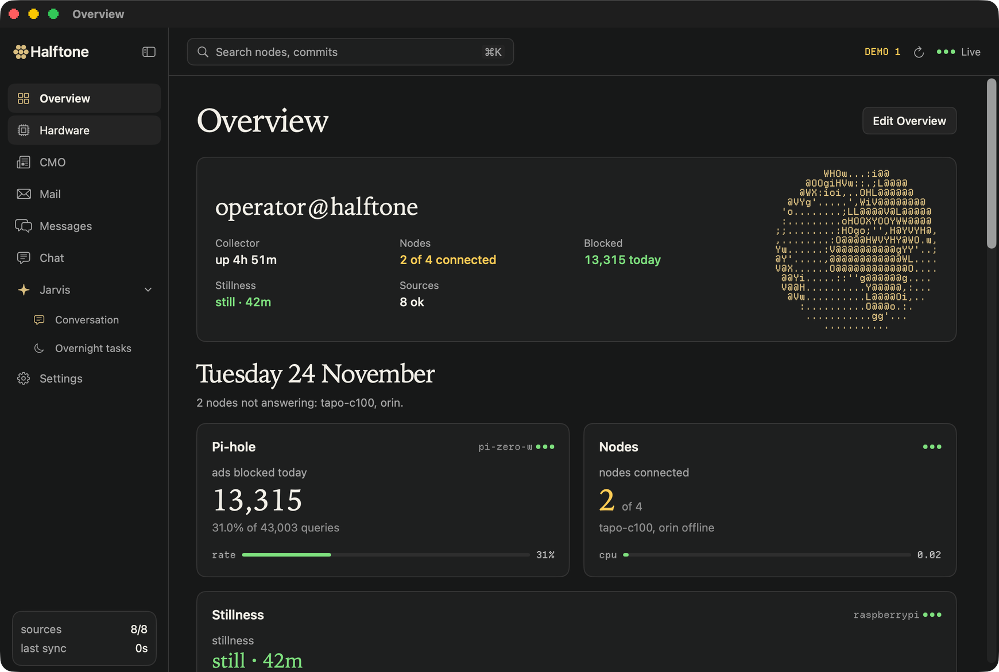
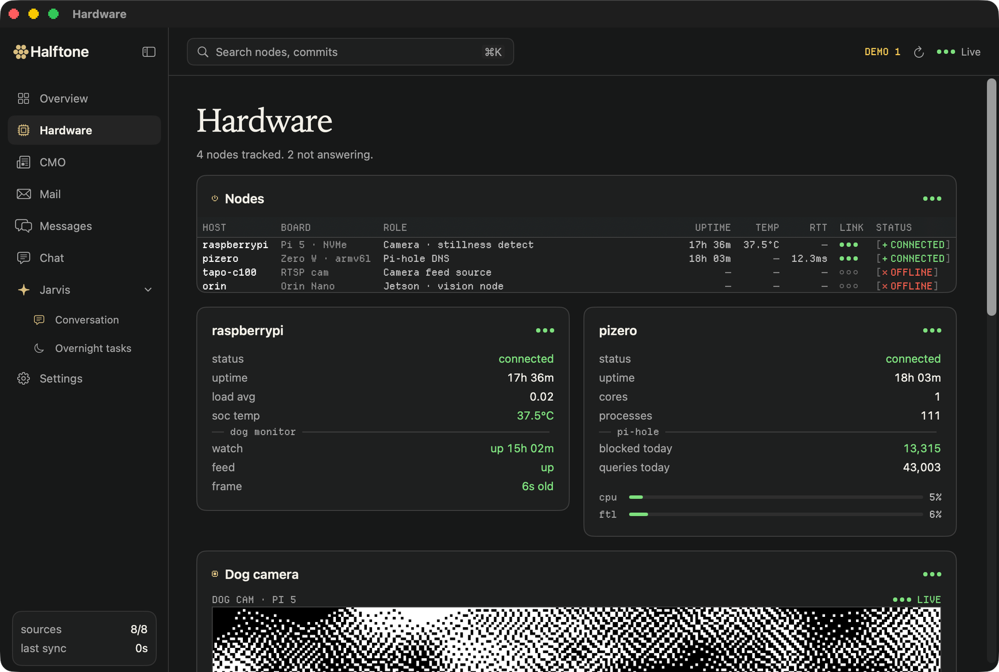
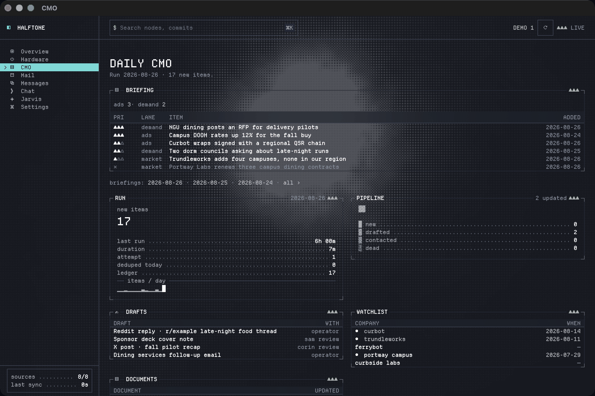
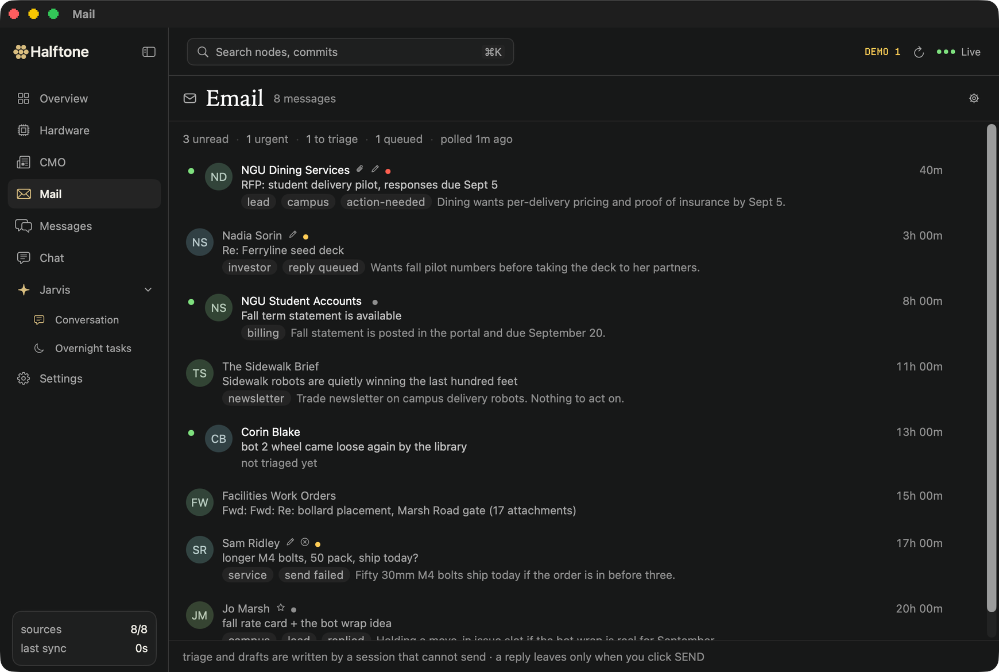
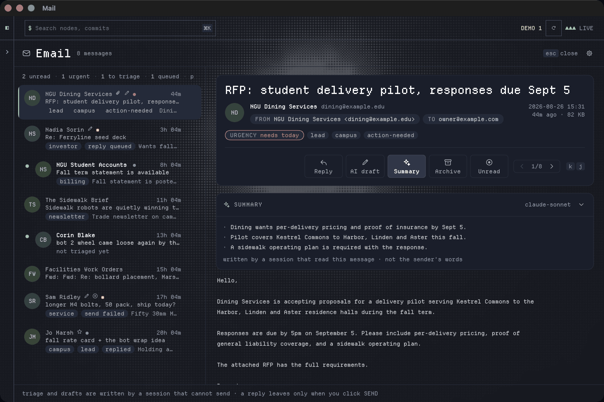
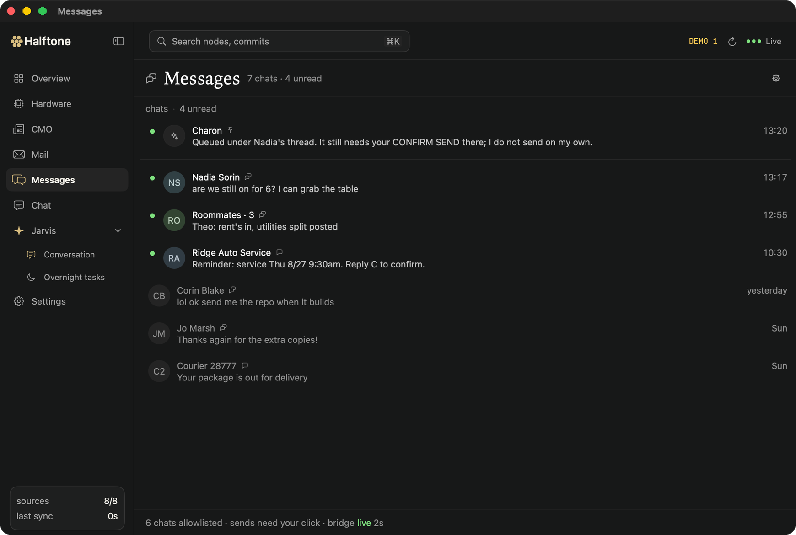
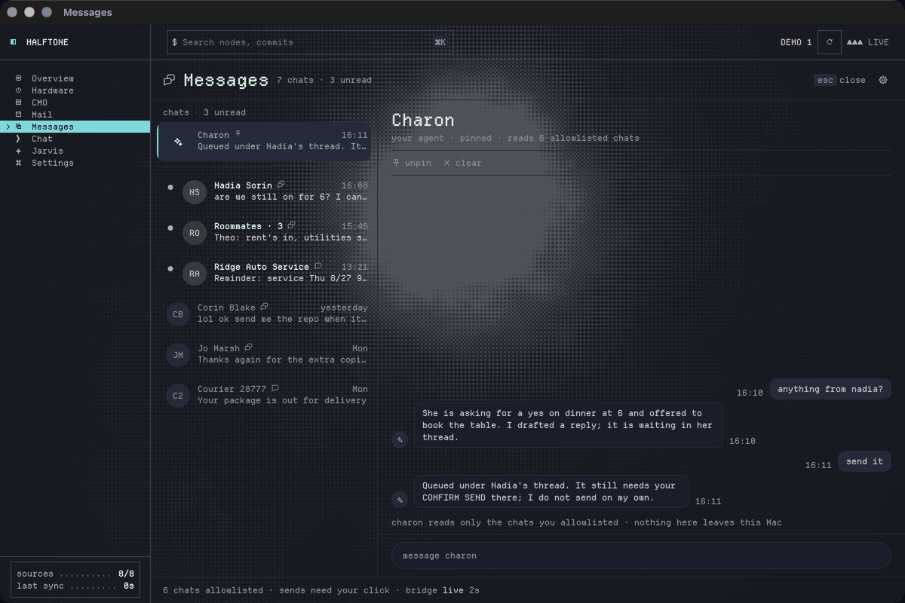
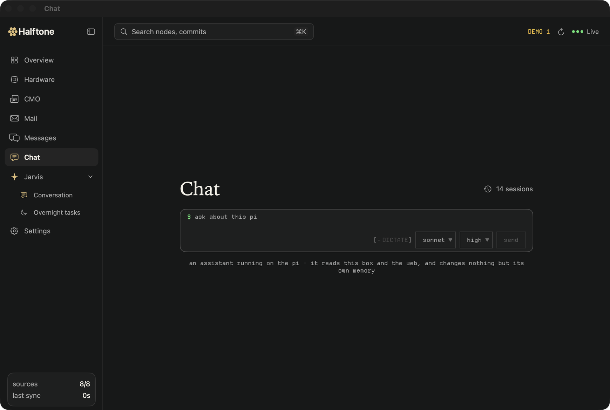
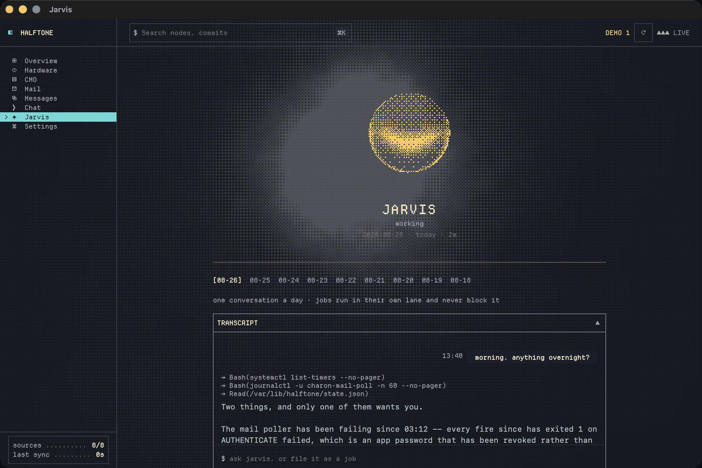
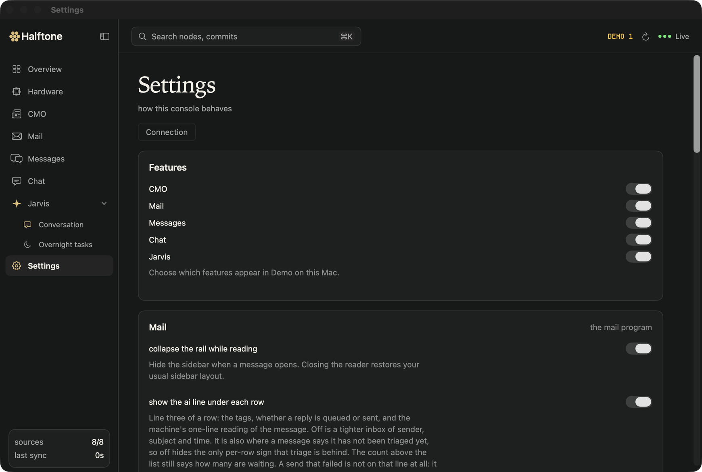

# Charon

Charon is a personal console for one person and their own machines. A Raspberry
Pi 5 sitting on a shelf collects telemetry, mirrors a mailbox, runs model
sessions and holds every piece of state. A native macOS app is the face you look
at. The two talk over a private network with a bearer token, and nothing here is
exposed to the internet.



What it does, concretely:

- **Telemetry.** Eight sources polled on their own intervals, each keeping its
  last good answer with an honest age beside it: a camera monitor, Pi-hole, node
  reachability, GitHub commits, daily health checks of the Pi itself, and the
  three feature stores below.
- **Mail.** A mailbox mirrored to files on the Pi, classified by a model session
  that has no network of its own, with reply drafts you can edit. A reply leaves
  only when a human clicks SEND twice.
- **Messages.** iMessage conversations you explicitly allow, pushed up from the
  Mac by a small background app, classified and drafted on the Pi, sent back
  through the Mac.
- **Chat and Jarvis.** Model sessions that run on the Pi, in their own working
  directories, under default-deny permission allowlists. They answer questions
  about the box they are running on. One of them can file background jobs.

This is a working system that was scrubbed of one household's details and
published. Every address, path, bundle id, domain and person in it is now an
example. See **Making it yours** below for the full list of what to change.

## What is in this repo

| Directory | What it is | Runs on |
|---|---|---|
| `mac/` | Two macOS apps from one xcodegen project: **Charon.app**, the SwiftUI console, and **Charon Bridge.app**, a windowless login item that carries iMessage | Your Mac, macOS 15+ (the Bridge, 14+) |
| `collector/` | The telemetry collector, the only listening socket in the system, plus the chat and Jarvis session runners and their permission environments | The Pi, Python 3.11, stdlib only |
| `mail/` | The mail and messages workers: an IMAP poller, a triage worker, an actions worker, a messages worker, their prompts, their systemd units, and an optional inbound mail path | The Pi, Python 3.11, stdlib only |

Component documentation lives next to the code: `collector/README.md`,
`collector/JARVIS-CONTRACT.md`, `collector/chat-env/README.md`, `mail/MESSAGES.md`,
`mail/mailhost/README.md`, `mac/SPEC.md`, `mac/SPEC-CONSOLE.md`, `mac/SPEC-CMO.md`,
`mac/MESSAGES-PROTOCOL.md`, `mac/TAGS.md`, `mac/Bridge/README.md`. This file is
the map and the setup order; those files are the reasoning.

There is no build system spanning the three. They are three programs that agree
on a wire format, and you can run any one of them without the other two.

## The console

Eight destinations on one window, `⌘1` through `⌘8`. Every shot below is the app
in **Demo mode**, which is what you get on first launch before you point it at a
Pi: the people, companies and figures in them are the invented cast described
under **Making it yours**, and none of the panels is reading a real machine.

**Hardware.** Every node the collector knows about, with the two that are not
answering said once above the table and again inside it. The camera panel fetches
its still with a bearer header rather than linking it, and whether there is a
feed at all is read from the JSON, never inferred from whether an image happened
to load.



**CMO.** A briefing produced by a scheduled model session on the Pi, with its run
record, its pipeline and its watchlist beside it. The row marked `×` is one you
dismissed: it loses its priority pips entirely rather than dimming them, because
the ranking was a claim about what to do next and you have answered it.



**Mail.** The mirrored mailbox. Line three of each row is the machine's reading:
the tags it chose, whether a reply is queued or sent, and whether it has been
triaged at all. A send that failed is a mark on line one instead, because
nothing above the list counts one.



Opening a message collapses the rail and puts the sender's own words on the
page. The summary above them is labelled with the model that wrote it and says
plainly that it is not the sender's words. `Reply` and `AI draft` both end at a
draft: the only thing that sends is your second click on SEND.



**Messages.** iMessage conversations you explicitly allowlisted, carried up from
the Mac by the Bridge. Chats you did not allowlist are not on this list because
they were never read.



The pinned thread at the top is the agent itself, and it is the clearest picture
of the consent model in the whole app: asked to send, it drafts, queues, and
then says it does not send on its own.



**Chat.** A model session running on the Pi, in its own working directory under
a default-deny allowlist. It reads the box and the web and changes nothing but
its own memory.



**Jarvis.** One conversation per day rather than one per task, with long work
running as jobs in a second lane that never blocks the conversation. The orb is
a 1-bit dither and its state is the session's state.

In **Jarvis → Overnight tasks**, choose **Set overnight tasks** to open a blank
Markdown page titled **Brain Dump**. Choose **Process** to have Codex propose
tasks immediately. Expand each card to review or edit its title, goal and
context, or delete it. Choose a start time and click **Done** to queue the
remaining tasks. Once the Pi confirms, you can close your Mac.

Each assignment has its own status, report, sources, and files. Completed runs
stay in your history. Choose **Show earlier tasks** to load another page.
Word documents and PDFs open in Quick Look. **Save a copy** keeps a file on
your Mac.

With an older collector, Charon reads its recent job list and the result text
it already provides. Full reports, older pages and archived files use the
[overnight reader routes](collector/JARVIS-CONTRACT.md#overnight-report-reader).



**Settings.** Every row carries its own reasoning, including the rows that are
fixed and explain why they are not a choice.



## Security and consent

This is stated first because it is the part worth reading before you decide to
run any of it.

**No model is in the send path.** `mail-triage.py` is the file that runs a model,
and it imports nothing that can open a socket. `mail-actions.py` is the file that
can send mail, and it imports nothing that can reach a model. The split is
structural rather than promised, and each half is checked by grepping the file
for the other half's imports:

```sh
cd mail
grep -c smtplib mail-triage.py                      # 0
grep -cE '^(import|from) llm\b' mail-actions.py     # 0
```

Those two commands are the whole proof, they take one second, and they cannot
quietly rot. `mail/MESSAGES.md` carries the same pair for the messages worker.

**Sending is a human click, twice.** The app's SEND control is disabled until
there is a reply address and non-empty text. The first click arms nothing on the
network: it opens a bordered strip naming the recipient, with the only
filled-cyan control in the entire app on it. The second click posts. Retrying a
failure always mints a new record and never re-posts an old one, because the
failure mode of an automatic retry is sending the same message twice.

**The recipient is computed on the Pi, never supplied.** `POST /v1/mail/send`
takes a message key and a body, and nothing else. The address comes off the
message being replied to, and so does the subject. The actions worker recomputes
the address from the stored record a second time before it opens a socket.
Anyone who steals the collector token can read the mailbox mirror and queue a
reply to an address that mailbox itself supplied. They cannot choose a recipient
and cannot log in to the account.

**The iMessage allowlist is enforced twice.** The Bridge drops rows from
conversations you have not allowed before anything leaves the Mac, counts them,
and never names them in its log. The collector refuses the same rows on its side.
A send is checked against the list again on the Mac before it is performed, even
though the collector already refused the ones it should have.

**Credentials are split by trust boundary.** The collector holds the listening
socket and no mail credentials. The mailbox password belongs to the poller and
the actions worker, which have no listening socket between them. The browser and
the collector share one token; the collector and the camera monitor share a
different one. The mail triage unit deliberately loads `secrets/env` (the model
provider's key) and never `secrets/mail-env` (the mailbox password), so the one
process that starts a model cannot be handed the mailbox.

**Model access differs by surface.** Chat and Jarvis talk use Claude. Background
research uses Codex CLI with the Pi operator’s ChatGPT sign-in.

| Surface | Directory on the Pi | May |
|---|---|---|
| Chat tab | `halftone-chat/env/` | read, plus write its own memory store through `bin/memory` |
| Jarvis talk | `halftone-chat/sayenv/` | the same, plus file background jobs through `bin/jarvis-job` |
| Jarvis work | Temporary directory for each research job | Search the web and return Markdown and text files for the runner to archive |
| Mail and messages triage | `charon-mail/mail-env/` | intended to be tool-less: an empty allow list and a deny on `Edit` over the tree |

`defaultMode` is `dontAsk` in the Claude environments, so anything not matched by an allow rule is
refused rather than queued behind a dialog nobody will answer. `deny` beats
`allow`, and the deny lists are the containment story: `.env` files, `~/.ssh`,
`secrets/`, every `.claude/` directory, and the per-process `/proc` files that
leak another service's environment. `NoNewPrivileges` on every unit makes sudo
structurally impossible rather than merely denied. The `ps` and `/proc` allow
rules are enumerated rather than opened, because `ps auxe` prints another
process's environment and that environment holds the collector token.

Read `collector/chat-env/README.md` before you widen any of those lists. It is
the rationale a JSON file cannot carry.

**Everything a model reads is data, not instruction.** Email bodies, message
text, web pages and journal lines all arrive fenced and marked untrusted, and
every field a model returns is re-validated in Python before it reaches disk.
`mail/test-injection.py` is the test for that, and it is worth running against
any model you swap in.

**One caveat, stated plainly.** The mail and messages workers set their session's
working directory to `mail-env/`, whose `settings.json` carries an empty allow
list. Whether the CLI picks that file up from there depends on where your version
of it looks for settings. Verify it on your install before treating it as a
boundary, or run one of the HTTP providers in `mail/llm.py`, which have no
filesystem to fence off in the first place. The two guards above it, the record
check and the recomputed recipient, hold on their own.

**Plain HTTP is deliberate, and so is the ATS exception.** The collector serves
plain HTTP bound to a tailnet address. App Transport Security exceptions in a
Mac app are keyed by hostname, and a raw tailnet IP has no hostname, so
`mac/Resources/Info.plist` sets `NSAllowsArbitraryLoads`. WireGuard is the
transport security here, not TLS. If you put the collector behind a real
certificate, delete that key from the plist. If you bind the collector to
`0.0.0.0` instead of your tailnet address, the token is protected only by your
wifi password and anything on that network can reach the camera proxy. Never
bind `::`: a dual-stack bind on a box with a global IPv6 address is one
permissive router rule away from publishing a camera feed with no NAT behind it.

## How the three components talk

```
   Mac                                  Raspberry Pi 5
   ---                                  --------------

   Charon.app  ──────── HTTP + bearer ────────▶  collector.py  :8788
     (sandboxed)        poll 10s                  the only listening socket
                                                  the only holder of the token
   Charon Bridge  ───── HTTP + bearer ────────▶     │
     (login item)       push, poll 3s               │  writes a record,
                                                    │  then a spool entry
   TTS host (optional) ◀── proxied by the Pi ──     ▼
                                             .queue / .actions directories
                                                    │
                                                    │  systemd .path units
                                                    ▼
                                        mail-poller · mail-triage
                                        mail-actions · messages-triage
                                        chat-runner · jarvis-say · jarvis-job
```

**Everything is HTTP over a tailnet with `Authorization: Bearer <token>`.** There
is no other transport and no second port. The browser console, which is optional
and not in this repo, also gets a same-origin `HttpOnly` cookie, because an
`` tag cannot send an Authorization header and the camera frame is rendered
through a canvas that reads its pixels back.

**The Mac is never called.** Every exchange is something a Mac process started.
The app polls telemetry every 10 seconds while its window is active and pauses
when it is not. The Bridge pushes new messages as they arrive and polls every
three seconds for queued sends and attachment requests. A closed lid pauses the
stream and it resumes from its cursor on the next wake, which is why "the bridge
has not reported" is a first-class state on the panel rather than an error.

**The collector never calls a worker, and no worker listens.** The coupling
between them is the filesystem, in one fixed order: the record is written first,
then a spool entry in a `.queue` or `.actions` directory. A systemd `.path` unit
watching that directory with `DirectoryNotEmpty=` starts the worker, which drains
the directory and deletes each entry as it finishes it. A queue that is still
non-empty when the worker exits re-fires the unit, so the retry path is "work is
still waiting" rather than "a process exited". Enable the `.path` unit, never the
`.service`: enabling the service runs a drain at every boot whether or not
anything is waiting.

**One writer per field.** The collector writes what arrived and what the human
decided. Each worker writes its own verdicts, drafts and status. The Mac writes
nothing on the Pi's disk directly. Where a field looks like it has two writers,
it does not: a chat thread's `queued` state is derived from the presence of a
spool file rather than stored, precisely because the collector files the entry
and the runner writes the status, and between those two moments no status exists.

**Sizes and caps are enforced at the door.** Message bodies never travel in
telemetry; they come back on a per-item route with a 64 KB ceiling. Reply bodies
cap at 8,000 characters, chat and Jarvis messages at 4,000, ingest at 512 KiB,
everything else at 64 KiB, and attachment uploads at 25 MB.

## The degradation model

Nothing in this system reports a failure it cannot back up, and "not configured"
is never drawn as a fault. Every source carries one of five statuses:

| Status | Means | Draw it as |
|---|---|---|
| `ok` | fresh | normally |
| `stale` | last known good, past its budget | the old value, with its age |
| `degraded` | reached it, some fields missing | what came back, null the rest |
| `dormant` | never configured | "not wired", not an error |
| `error` | configured, tried, failed, nothing cached | a fault |

**A source whose secret is missing reports `dormant` and is never retried.** That
is a configuration statement, not a failure. The collector therefore runs fine
with none of the optional secrets set, and you can add them one at a time and
watch panels come alive. A source that reads local files, such as mail, is
`dormant` until the worker behind it has run once and left a state file, and it
is re-checked on every snapshot, so it wakes on its own the moment the first run
lands.

**A check whose instrument is absent is omitted, never scored as a failure.**
There is no `vcgencmd` on a Mac, and counting a missing thermometer as a fever
is how a panel earns being ignored.

**There are two independent staleness layers.** `age_s` is how old our copy is;
fields inside the payload carry whether the upstream itself admits to being
stale. The envelope takes the worse of the two, because a three-second-old
answer from a monitor that has seen nothing for four hours would otherwise
render as a green lamp over a dead camera.

**The staleness budgets are asymmetric on purpose.** A stale counter is still
roughly true, so Pi-hole coasts for an hour. A stale reachability claim is
actively false, so node results expire to `error` after 90 seconds.

The same idea runs through the features. A disabled unit is not an error: turn
off the triage path unit and mail still arrives and is still readable, it simply
arrives without tags. Turn off the actions path unit and SEND still writes a
record, the record stays `queued` forever, and no mail leaves the box. Leave the
`tts` block out of the config and voice is off, both voice routes answer 503, the
client draws a dim word, and the text lane is untouched.

## Setup, in order

You need: a Mac running macOS 15 or later with Xcode and
[xcodegen](https://github.com/yonaskolb/XcodeGen), a Raspberry Pi 5 running
Debian Bookworm with Python 3.11, and a Tailscale account. No venv, no pip, no
node. The Pi side is stdlib Python by rule.

Steps 4 through 7 are all optional and independent. Doing only 1 through 3 gives
you a working telemetry console.

### 1. Tailscale on both machines

Install it on the Mac and on the Pi and note the Pi's tailnet address. Every
example in this repo uses `100.64.0.2` for the Pi. That address is the one thing
the two halves have to agree on.

### 2. The collector

On the Pi:

```sh
mkdir -p ~/halftone-collector
# copy the contents of collector/ into it, then:
cd ~/halftone-collector
cp config.example.json config.json
cp .env.example .env && chmod 600 .env
echo "COLLECTOR_API_TOKEN=$(openssl rand -hex 32)" >> .env
```

Generate the token on the machine that will serve it, never elsewhere and copied.
The command substitution above is stored unexpanded in shell history, so your
history records the command rather than the secret. The server refuses to start
with a token under 24 characters.

Edit `config.json`: set `api_bind` to the Pi's **tailnet** address, and fix the
`nodes` list and the `pihole` host to match your own network, or delete the
entries you do not have. Then:

```sh
python3 collector.py once      # poll everything, print the payload, exit
python3 collector.py serve     # run it in the foreground once to watch it
```

When it looks right, install the unit:

```sh
# every directory the unit's ReadWritePaths= lines name, minus the ones you delete:
mkdir -p ~/charon-mail/{memory,ask,mail,messages} ~/halftone-chat/{threads,jarvis}
sudo cp halftone-collector.service /etc/systemd/system/
sudo systemctl daemon-reload
sudo systemctl enable --now halftone-collector
```

Read that unit file before you enable it. Its `ReadWritePaths=` lines are the
whole of what the collector may write, and **systemd refuses to start a unit
whose `ReadWritePaths` names a directory that does not exist.** That is what the
`mkdir` above is for. Create the directories for the features you are enabling,
and delete the lines for the ones you are not: `memory` and `ask` belong to the
CMO job, which is not in this repo, and `mail`, `messages`, `threads` and
`jarvis` come back in steps 4 through 6 anyway. The refusal is deliberate: a typo
should fail loudly rather than silently grant a parent directory.

### 3. The Mac app

```sh
cd mac
xcodegen generate
xcodebuild -project HalftoneMail.xcodeproj -scheme HalftoneMail \
  -configuration Debug -derivedDataPath DerivedData build
open DerivedData/Build/Products/Debug/Charon.app
```

It opens in **Demo mode** against built-in fixtures, so you can click through
every tab before any Pi exists. The fixtures are invented people at invented
companies; see **Making it yours**.

To point it at the Pi, either open the gear and fill in the base URL and token,
or run `scripts/connect-live.sh`, which pulls the token off the Pi over ssh,
writes it to the login Keychain without printing it, checks that the collector
accepts it, and relaunches the app in live mode. The token is stored in the
Keychain under `com.example.charon.collector` and never in preferences.

The project signs ad-hoc (`CODE_SIGN_IDENTITY: "-"`), because this tree carries
no developer identity. To sign for real, set `CODE_SIGN_STYLE` to `Automatic` and
add your own `DEVELOPMENT_TEAM` in `project.yml`.

### 4. Mail

The mail workers deploy to `/home/pi/charon-mail`, which is a different directory
from the collector's, because they hold credentials the collector must never see.

```sh
# on the Pi
mkdir -p ~/charon-mail/{bin,mail-env,secrets,mail/.queue,mail/.actions,memory}
# copy mail/*.py            -> ~/charon-mail/bin/
# copy mail/mail-env/*.md   -> ~/charon-mail/mail-env/
# copy mail/mail-env/settings.json -> ~/charon-mail/mail-env/
install -m 600 mail/secrets/env.example      ~/charon-mail/secrets/env
install -m 600 mail/secrets/mail-env.example ~/charon-mail/secrets/mail-env
```

Fill in both secrets files. `secrets/mail-env` carries the mailbox host, address
and password; `secrets/env` carries the model provider's credential and nothing
else. Keep them separate: that separation is what stops the session that runs a
model from being handed the mailbox.

If your CLI reads permissions from `.claude/settings.json` relative to its working
directory, put the settings file at `~/charon-mail/mail-env/.claude/settings.json`
instead, and verify that it is actually loaded.

Edit `mail-env/triage.md` and `mail-env/reply.md` before the first run. Both
carry an `[OWNER CONTEXT]` block describing a fictional company, and it is the
single section of those prompts that is not reusable as written.

Then the units, with the poll timer **last**:

```sh
sudo cp mail/charon-mail-*.{service,path,timer} /etc/systemd/system/
sudo systemctl daemon-reload
sudo systemctl enable --now charon-mail-triage.path
sudo systemctl enable --now charon-mail-actions.path
sudo systemctl enable --now charon-mail-poll.timer     # the ignition
```

The poller is the ignition. Until its timer is enabled nothing is read, nothing
is classified and nothing is drafted, so each layer can be watched on its own
before the one above it is armed. Each unit stops independently with
`sudo systemctl disable --now <unit>`, and disabling the actions path unit is the
kill switch for outward action.

`mail/mailhost/` is an entirely optional inbound path for giving the agent its
own mailbox on your own domain, using Cloudflare Email Routing, a Worker, a
cloudflared tunnel, Stalwart and an outbound relay. Its README is a standalone
runbook. Any ordinary IMAP and SMTP mailbox works instead, and the poller does
not care which.

### 5. Messages

Needs step 4's directory layout, plus the Bridge on the Mac.

```sh
# on the Pi
mkdir -p ~/charon-mail/messages/{.queue,ai,drafts,summaries}
touch    ~/charon-mail/messages/.triage.lock
sudo cp mail/charon-messages-triage.{path,service} /etc/systemd/system/
sudo systemctl daemon-reload
sudo systemctl enable --now charon-messages-triage.path
```

Then build and install the Bridge:

```sh
cd mac
xcodebuild -project HalftoneMail.xcodeproj -scheme CharonBridge \
  -configuration Debug -derivedDataPath DerivedData build
cp -R "DerivedData/Build/Products/Debug/Charon Bridge.app" /Applications/
open "/Applications/Charon Bridge.app"
```

Copy it somewhere permanent before the first launch: that launch registers a
login item at the path it is standing in, and a login item pointing into a build
directory breaks on the next clean build. It needs Full Disk Access to read the
Messages database and Automation access to Messages to send. Its first launch is
the only time it shows anything. `mac/Bridge/README.md` covers the permissions,
the backfill and the attachment rules; `mac/MESSAGES-PROTOCOL.md` is the wire
format. No conversation is read until you allow it in the app.

### 6. Chat and Jarvis

Install the native Codex CLI on the Pi to use **As job** in Jarvis. Sign in once
as the user that runs the service. The default executable is `~/.local/bin/codex`.
See the [Codex CLI installation guide](https://developers.openai.com/codex/cli/).

```sh
install -d -m 0700 ~/.codex-jarvis
CODEX_HOME="$HOME/.codex-jarvis" ~/.local/bin/codex login
CODEX_HOME="$HOME/.codex-jarvis" ~/.local/bin/codex login status
```

Create the service directories first, because
`ReadWritePaths=` fails on a path that is not there and a `.path` unit watching a
missing directory sits inactive forever while looking healthy.

```sh
mkdir -p ~/halftone-chat/{bin,memory,threads/.queue,threads/.stop}
mkdir -p ~/halftone-chat/jarvis/{days,jobs,.say,.jobs,.stop,.jobstop,.intake-jobs,.scheduled}
mkdir -p ~/halftone-chat/{env,sayenv,jobenv}/.claude

cp collector/chat-runner.py       ~/halftone-chat/bin/
cp collector/jarvis-say-runner.py ~/halftone-chat/bin/
cp collector/jarvis-job-runner.py ~/halftone-chat/bin/
cp collector/jarvis_intake.py     ~/halftone-chat/bin/
cp collector/jarvis-job-file.py   ~/halftone-chat/bin/jarvis-job
cp collector/memory-tool.py       ~/halftone-chat/bin/memory
cp collector/memory-taint.py      ~/halftone-chat/bin/memory-taint
chmod +x ~/halftone-chat/bin/{jarvis-job,memory,memory-taint}

cp collector/chat-env/CLAUDE.md          ~/halftone-chat/env/
cp collector/chat-env/settings.json      ~/halftone-chat/env/.claude/
cp collector/jarvis-say-env/CLAUDE.md    ~/halftone-chat/sayenv/
cp collector/jarvis-say-env/settings.json ~/halftone-chat/sayenv/.claude/
cp collector/jarvis-job-env/CLAUDE.md    ~/halftone-chat/jobenv/
cp collector/jarvis-job-env/settings.json ~/halftone-chat/jobenv/.claude/

sudo cp collector/halftone-chat.{service,path} /etc/systemd/system/
sudo cp collector/halftone-jarvis-say.{service,path} /etc/systemd/system/
sudo cp collector/halftone-jarvis-job.{service,path} /etc/systemd/system/
sudo cp collector/halftone-jarvis-intake.{service,path} /etc/systemd/system/
sudo systemctl daemon-reload
sudo python3 collector/install-feature-control.py --user pi --feature jarvis --extend-pairs \
  --pair halftone-jarvis-say.path:halftone-jarvis-say.service \
  --pair halftone-jarvis-job.path:halftone-jarvis-job.service \
  --pair halftone-jarvis-intake.path:halftone-jarvis-intake.service
sudo systemctl enable --now halftone-chat.path
sudo systemctl enable --now halftone-jarvis-say.path
sudo systemctl enable --now halftone-jarvis-job.path
sudo systemctl enable --now halftone-jarvis-intake.path
```

The three helpers are copied without their `.py` extension on purpose: the allow
rules in the permission files name those exact paths, so `bin/memory` has to be
at `bin/memory`. Every `CLAUDE.md` in those environments describes a specific
machine, and you should edit each one to describe yours; they are the standing
instructions those sessions load on every turn. `collector/JARVIS-CONTRACT.md` is
the agreement the four programs keep, including the compaction rules and the
context warning.

### 7. Voice (optional)

Add a `tts` block to `config.json` and `HALFTONE_TTS_KEY` to `.env`. Both halves
or neither: a base with no key is treated as not configured rather than as a
third state. The contract your TTS host has to honor is in the next section.

## Making it yours

To configure Overview, follow the [widget setup guide](mac/Resources/WidgetHelp/AGENTS.md). The Mac app also includes it in **Copy setup request**.

To design a custom card, connect JSON, or add a Swift display, follow the [widget design guide](mac/Resources/WidgetHelp/AGENT-WIDGET-DESIGN.md).

Every identifying value in this repo is an example. Nothing breaks if you leave
them, but nothing works either. This is the complete list.

| Value in the tree | What it stands for | Where |
|---|---|---|
| `100.64.0.2` | the Pi's tailnet address | `collector/deploy.sh`, `mac/scripts/connect-live.sh`, `mac/Sources/Settings.swift` (`Connection.defaultBase`), `mac/Bridge/Collector.swift`, and the docs. The two Swift defaults are duplicated on purpose; change both |
| `100.64.0.4` | a fourth machine on the tailnet, used as an example node | `collector/config.example.json`, `collector/chat-env/CLAUDE.md` |
| `<mac-tailnet-ip>` | the Mac hosting the optional voice service. `100.64.0.3` is the address the examples would use for a second machine | `collector/config.example.json`, the `tts.base` key |
| `10.0.0.2`, `10.0.0.3`, `10.0.0.4` | LAN addresses for the Pi, a Pi Zero running Pi-hole, and a camera | `collector/config.example.json`, `collector/chat-env/CLAUDE.md` |
| `/home/pi` | the Pi user's home. The deploy roots are `/home/pi/halftone-collector`, `/home/pi/charon-mail` and `/home/pi/halftone-chat` | every systemd unit, every worker docstring, the permission allowlists, `collector.py`'s defaults |
| `pi@100.64.0.2` | the ssh target | `collector/deploy.sh`, `mac/scripts/connect-live.sh` |
| `pi` | the service user in every unit's `User=`/`Group=` | all systemd units |
| `com.example.charon` | the app's bundle id. `.collector` is the Keychain service, `.bridge` is the Bridge | `mac/project.yml`, `mac/Sources/Keychain.swift`, `mac/Bridge/Collector.swift`, `mac/scripts/connect-live.sh` |
| `charon@example.com`, `example.com`, `mail.example.com`, `mail-ingest.example.com`, `<TUNNEL_ID>` | the optional self-hosted mail domain | `mail/mailhost/` throughout, `mail/secrets/mail-env.example` |
| `agent@example.com` | the mailbox the poller reads | `mail/secrets/mail-env.example` |
| "the operator" | you, in every prompt and standing instruction. Left generic on purpose, but a name reads better | `collector/*-env/CLAUDE.md`, `mail/mail-env/*.md` |
| `[OWNER CONTEXT ... END OWNER CONTEXT]` | a worked example of who a mailbox belongs to. **Replace this before the first run.** It is what decides most of the tags, and a two-line version measurably flattens them | `mail/mail-env/triage.md`, `reply.md`, `messages-reply.md` |

**Changing the bundle id costs you the stored token.** The Keychain service string
and the `defaults` domain are both derived from it, so renaming it after a token
is stored orphans that token. Do it before step 3 or not at all.

**Jarvis calls you "sir".** That is a persona, not a setting. The openers and
acknowledgments in `collector/jarvis-say-env/CLAUDE.md` are written that way, and
both canned-voice manifests carry the same wording in their phrase text, which is
also what the Mac's shipped clips say out loud. Changing it is two edits: rewrite
those lines and the phrases that match them, then re-render the clips you
changed. `collector/canned/manifest.json` carries its own regeneration note, and
the shelf in `mac/Resources/Canned/` is described under *Attribution* below.
Nothing breaks if you rewrite the words and stop there: a sentence that no longer
matches a clip is simply spoken live, because the shelf is an optimisation and
never a gate.

**The demo fixtures are invented and consistent.** The Mac app's demo mode, the
prompt examples and the test assertions share one cast: a fictional delivery
startup called Ferryline, a fictional Northgate University, and people named Mira
Vale, Nadia Sorin, Corin Blake, Sam Ridley and Jo Marsh. If you rename any of
them, the tests that assert on those names are the ones to run.

**Every one of those fixtures is fiction, all the way down.** Not just the
people and the companies: the competitor dossiers and every figure in them, the
watchlist entries, the funding rounds, the campus contracts, the news items, the
repository and commit names in the commits panel, the mail threads, the text
conversations, and the numbers on every panel of demo mode. None of it describes
a real person, a real company or a real event, and any resemblance to one is
coincidental. Nothing in this repo makes a claim about a real organisation.

**The demo phone number `+14085550142` and the group id `chat8291` are load
bearing.** The Bridge's unit tests assert on sha256 literals derived from them.
Leave them alone.

## Optional external services

None of these ship here. Each one is absent-tolerant: the feature that uses it
reports itself unconfigured rather than broken.

**A TTS host, for Jarvis's voice.** The collector proxies audio so the browser
never talks to the host directly and the audio stays same-origin with the page
that plays it. Point `tts.base` in `config.json` at anything that answers two
routes:

- `POST <base>/speak`, header `X-Halftone-Key: <HALFTONE_TTS_KEY>`, body
  `{"text": "one sentence"}`, answering a complete `audio/wav` file. Not chunked.
  Answer 401 when the key is wrong; the collector never passes your status
  through, because a 401 relayed as its own would read as a bad cookie to a
  console whose cookie is fine.
- `POST <base>/warm`, no key, no body, any answer. It exists so a cold model can
  be started before the first sentence arrives.

Everything else is the collector's job. A sleeping host mutes Jarvis and never
breaks him: a transport failure is a 502 with a reason and a dim word beside an
intact text lane. The reference implementation was a Kokoro server on a Mac under
launchd socket activation, which is why `/warm` is worth having.

**`reddit-fetch`, a read-only Reddit reader.** The three session environments
allow `/home/pi/feed-worker/reddit-fetch.py`, and `memory-taint.py` sniffs for it
as a third fetch channel. It is not in this repo. Without it those allow lines
match nothing and the sessions simply cannot read Reddit. Any script at that path
that prints JSON on stdout will do; the standing instructions describe the three
verbs the sessions expect.

**The web console.** The collector serves whatever static build sits in
`dashboard_dir`, and mints a browser cookie for it. That console is a separate
project and is not part of this repo. The Mac app is a full port of it, so you do
not need it, and every route is equally usable from `curl`.

**A camera monitor** on `127.0.0.1:8787` with its own bearer token. The `camera`
source and the frame proxy read it. Without it, that source stays dormant.

**A model provider.** `mail/llm.py` is the only file in the mail slice that can
reach a model, and it speaks three backends: the Claude Code CLI as a subprocess
(the default), the Anthropic API, and anything OpenAI-compatible, which includes
OpenRouter, Ollama, LM Studio, vLLM, Groq and Together. Callers ask for a tier,
cheap or good, and the file resolves it. To change providers:

1. Set `CHARON_LLM_PROVIDER` in `secrets/env`.
2. Set the key, and for `openai-compat` the base URL and both model names, which
   are required because there is no sensible default for a backend that could be
   any of a dozen services.
3. `python3 test-llm.py`, offline, checks that each tier resolves and each
   backend's failures normalise.
4. `python3 test-wiring.py`, which stands up a deliberately lying HTTP server and
   runs the real worker against it over a throwaway mailbox.
5. `python3 test-injection.py`, which costs one cheap call and one good call, and
   is the only one that can tell you whether the model you picked still honors
   the fenced-output contract under attack. Run it before and after any change to
   the model, the tier, the batch size or the prompts.

The chat and Jarvis runners on the collector side are separate and speak to the
CLI directly; they do not go through `llm.py`.

## Deliberately absent

Named so they are decisions rather than omissions.

- **The Daily CMO agent.** The collector's `/v1/cmo/*` routes read files a daily
  job leaves on disk, and the Mac app has a CMO tab that draws them. That job is a
  content pipeline specific to one person's business and is not published. Without
  it the `cmo` source stays `dormant` forever, the tab is empty, and nothing errors.
  Two `ReadWritePaths=` lines in `halftone-collector.service` name that job's
  directories; delete them if you are not going to create them.
- **The camera monitor** and its stillness detection, which is a separate service
  on the same Pi.
- **The web console and its design system**, two private repos the Mac app was
  ported from. Header comments in `mac/Sources/` refer to them.
- **The `imsg` CLI binary.** The Bridge fetches it once into its own Application
  Support directory, checks the archive and the executable against digests
  compiled into the app, refuses to run anything that does not match, and deletes
  the injection dylib in the archive rather than installing it. It is MIT, pinned
  at 0.14.1, and its license is written beside the binary.
- **The rendered voice clips for the collector's shelf.** `collector/canned/`
  ships a manifest and no audio, which the collector reports once at startup and
  treats as the feature switched off. See below.

## Tests

None of these start a model, open a socket beyond loopback, or touch a Pi.

```sh
(cd collector && python3 -m unittest tests.test_messages_routes \
                                      tests.test_memory_tool \
                                      tests.test_memory_digest -v)
(cd mail && python3 test-messages.py)      # 115 checks, about a second
(cd mail && python3 test-llm.py)
(cd mail && python3 test-wiring.py)
(cd mail && python3 test-mail-actions.py)
(cd mac  && Bridge/tests/run-units.sh)     # framing, records, keys, the allowlist
(cd mac  && Bridge/tests/run-dry.sh)       # the whole Bridge against a fake helper and a stub Pi
```

`mail/test-injection.py` is the exception: it makes two real model calls. The
greps in the security section and in `mail/MESSAGES.md` are tests too, and they
are the cheapest ones here.

## Attribution

**Departure Mono** by Helena Zhang (departuremono.com), licensed under the SIL
Open Font License 1.1. `mac/Resources/Fonts/DepartureMono-Regular.ttf` ships
unmodified, and the full license text is beside it in
`mac/Resources/Fonts/OFL.txt`. No Reserved Font Name is declared, so the OFL's
renaming requirement does not apply.

**The canned voice clips** in `mac/Resources/Canned/` were generated with Kokoro,
voice `am_michael`. They are pre-rendered so that the phrases Jarvis says most
play with no latency and work while the machine that hosts the voice service is
asleep. To replace them, render each phrase in `manifest.json` to the file named
beside it with any Kokoro-class TTS and keep one voice across the set: the voice
only has to match itself, since every phrase not on the shelf is spoken live
anyway. `collector/canned/manifest.json` is the same idea and ships with no audio
at all, so a fresh clone starts with the shelf empty, which the collector reports
once and treats as switched off rather than broken. The two shelves are
independent: the Mac's is 40 clips keyed by sentence and the Pi's is ten phrases
keyed by filename, neither one reads the other, and rendering one leaves the
other exactly as it was.

**The globe's land mask** in `mac/Sources/Kit/LandMask.swift` is rasterised from
Natural Earth's 110m land polygons (`ne_110m_land`), which are explicitly public
domain and require no attribution. Credited anyway, because knowing where a
32,768-cell bitmap came from is worth more than the two lines it costs.

**Both pieces of artwork are computed, not drawn.** `mac/Resources/Backdrop.png`
and `AppIcon.icns` come out of `mac/scripts/generate-art.py`, which is a formula
plus a seeded RNG, so re-running it reproduces the shipped bytes exactly. There
is no source image anywhere in this repo. To change the art, edit the numbers.

## License

MIT. See `LICENSE`.
